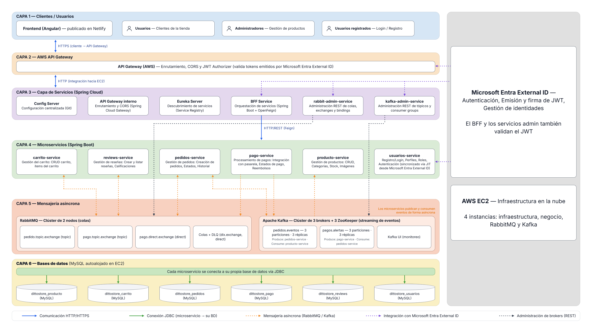

<p align="center">
  
</p>
<h1 align="center">Ditto Store</h1>
 
E-commerce de cartas Pokémon TCG construido con arquitectura de microservicios, autenticación real vía Microsoft Entra External ID, mensajería asíncrona con RabbitMQ, streaming de eventos con Apache Kafka y despliegue en AWS.
 
---

## Descripción del proyecto

Ditto Store es una tienda en línea de cartas y cajas de Pokémon TCG. El sistema no cuenta con registro propio de usuarios: la autenticación se delega completamente a un tenant de **Microsoft Entra External ID**, y el rol de cada usuario (Cliente o Administrador) se gestiona en el backend propio.

La aplicación está compuesta por:

- Un **backend de microservicios** en Spring Boot, con descubrimiento de servicios, configuración centralizada y un Backend For Frontend (BFF) que valida los tokens JWT.
- Un **frontend en Angular** con dos experiencias diferenciadas por rol: la tienda para clientes y un panel de administración.
- Una capa de **API Manager en AWS** (HTTP API Gateway) que actúa como puerta de entrada pública al backend, con su propio Authorizer JWT.
- Un **clúster RabbitMQ de 2 nodos** para la comunicación asíncrona entre microservicios, con colas, exchanges, DLQ y un microservicio administrador (`rabbit-admin-service`).
- Un **clúster Apache Kafka (3 brokers + 3 ZooKeeper)** con Kafka UI, dos tópicos (`pedidos.eventos` y `pagos.alertas`) y un microservicio administrador (`kafka-admin-service`), que complementa a RabbitMQ con analítica de ventas y detección de pagos sospechosos.

---

## Arquitectura


La autenticación corre en paralelo: el frontend usa **MSAL** para autenticar contra Azure AD, obtiene un token JWT, y ese mismo token viaja en cada request hasta el BFF (o directo a `producto-service`/`reviews-service` en las rutas que van sin pasar por el BFF), que lo valida (firma, issuer, audience y vigencia) antes de dejar pasar la petición.

La capa de mensajería asíncrona combina dos tecnologías con roles distintos: **RabbitMQ** coordina las reacciones del proceso de compra (comprobantes, reembolsos, vaciado del carrito, avisos a reseñas) y **Kafka** conserva los eventos de pedidos y pagos para analítica y detección (ver [Streaming de eventos con Apache Kafka](#streaming-de-eventos-con-apache-kafka)).

> Hay **dos capas de CORS** independientes en el camino: la del AWS API Gateway (a nivel de API, configurable en la consola) y la del API Gateway interno de Spring (`CorsConfig.java`). Si se agrega un nuevo dominio de frontend, hay que agregarlo **en ambas**, o el backend interno rechazará la petición con `403` aunque AWS ya la haya dejado pasar.

---

## Stack tecnológico

| Capa | Tecnología |
|---|---|
| Backend | Java 17, Spring Boot 4.0.8, Spring Cloud (Eureka, Config Server, Gateway, OpenFeign) |
| Base de datos | MySQL 8 |
| Mensajería | RabbitMQ 4.2 (clúster de 2 nodos con Docker Compose), Spring AMQP |
| Streaming de eventos | Apache Kafka 3.5 (Confluent Platform 7.5.0): clúster de 3 brokers + 3 ZooKeeper con Docker Compose, Kafka UI y Spring for Apache Kafka |
| Frontend | Angular (standalone components), MSAL v4 |
| Autenticación | Microsoft Entra External ID (Azure AD, tipo CIAM) |
| Nube | AWS (EC2, API Gateway) — cuenta de laboratorio estudiantil |
| Hosting frontend | Netlify (build vía variable de entorno, ver más abajo) |
| Build | Maven (backend), Angular CLI (frontend) |

---

## Estructura del repositorio

```
DittoStore/
├── backend/
│   ├── pom.xml                      # POM padre (dependencias compartidas)
│   ├── infrastructure/
│   │   ├── pom.xml
│   │   ├── eureka-server/
│   │   ├── config-server/
│   │   ├── api-gateway/             # Gateway interno Spring Cloud (CORS + rutas)
│   │   ├── bff-service/
│   │   ├── rabbit-admin-service/    # Administrador REST de colas, exchanges y bindings
│   │   └── kafka-admin-service/     # Administrador REST de tópicos y consumer groups de Kafka
│   └── businessdomain/
│       ├── pom.xml
│       ├── producto-service/
│       ├── usuarios-service/
│       ├── carrito-service/
│       ├── pedidos-service/
│       ├── pago-service/
│       └── reviews-service/
├── config-repo/                     # Configuración centralizada (Config Server)
├── docker-compose.yml               # Clúster RabbitMQ de 2 nodos
├── rabbitmq/
│   └── cluster.conf                 # Formación automática del clúster
├── docker-compose.kafka.yml         # Clúster Kafka: 3 ZooKeeper + 3 brokers + Kafka UI
├── kafka/
│   ├── topics/                      # Definición (JSON) de los tópicos y sus parámetros
│   ├── crear-topicos.sh             # Crea los tópicos mediante kafka-admin-service
│   └── inspeccionar.sh              # Lista y describe tópicos y consumer groups
└── frontend/
    ├── set-env.js                   # Genera environment.prod.ts en cada build (ver más abajo)
    ├── src/app/
    │   ├── core/                    # Servicios, guards, modelos compartidos
    │   ├── features/
    │   │   └── admin/               # Panel de administración
    │   ├── shared/                  # Navbar, footer, componentes reutilizables
    │   ├── pages/                   # Páginas públicas de la tienda
    │   └── msal.config.ts           # protectedResourceMap: qué rutas llevan el Bearer token
    └── src/environments/
```

---

## Requisitos previos

- Java 17
- Maven (o usar el wrapper `./mvnw` incluido)
- Node.js 18+ y npm
- MySQL (local, ej. vía Laragon/XAMPP, o accesible remotamente)
- Docker y Docker Compose (para RabbitMQ y Kafka)
- Angular CLI (`npm install -g @angular/cli`)
- Una cuenta de Azure con un tenant de Microsoft Entra External ID configurado (ver sección de Autenticación)

---

## Levantar el backend en local

1. **Configura MySQL**: crea las 6 bases de datos vacías (se autogeneran las tablas vía JPA):
```sql
   CREATE DATABASE dittostore_producto;
   CREATE DATABASE dittostore_usuarios;
   CREATE DATABASE dittostore_carrito;
   CREATE DATABASE dittostore_pedidos;
   CREATE DATABASE dittostore_pago;
   CREATE DATABASE dittostore_reviews;
```
   Por defecto, cada microservicio se conecta con el usuario `root` sin contraseña (ajusta en cada `application.properties` si el entorno usa otras credenciales).

2. **Compila el backend completo**:
```bash
   cd backend
   ./mvnw clean package -DskipTests
```

3. **Levanta RabbitMQ** (desde la raíz del repositorio; sin archivo `.env` usa `guest/guest`):
```bash
   docker compose up -d
```
   Dashboard en `http://localhost:15672`.

   **Kafka (opcional en local, requiere unos 2 GB de RAM libres)**: levanta el clúster y Kafka UI con
```bash
   docker compose -f docker-compose.kafka.yml up -d
```
   Kafka UI queda en `http://localhost:8090` y los brokers en `localhost:9092`, `9093` y `9094`. La creación automática de tópicos está desactivada: crea `pedidos.eventos` y `pagos.alertas` con `kafka/crear-topicos.sh` (ver [Tópicos](#tópicos)) una vez levantado `kafka-admin-service`, o desde Kafka UI (**Add a Topic**, con 3 particiones y 3 réplicas).

4. **Levanta los servicios en este orden** (cada uno en su propia terminal, o usando Spring Boot Dashboard):
```bash
   # 1. Eureka Server (registro de servicios)
   java -jar infrastructure/eureka-server/target/eureka-server-0.0.1-SNAPSHOT.jar

   # 2. Config Server (configuración centralizada, vía config-repo/ en este mismo repo)
   java -jar infrastructure/config-server/target/config-server-0.0.1-SNAPSHOT.jar

   # 3. API Gateway, BFF y administradores de RabbitMQ y Kafka
   java -jar infrastructure/api-gateway/target/api-gateway-0.0.1-SNAPSHOT.jar
   java -jar infrastructure/bff-service/target/bff-service-0.0.1-SNAPSHOT.jar
   java -jar infrastructure/rabbit-admin-service/target/rabbit-admin-service-0.0.1-SNAPSHOT.jar
   java -jar infrastructure/kafka-admin-service/target/kafka-admin-service-0.0.1-SNAPSHOT.jar

   # 4. Los 6 microservicios de negocio (orden indistinto entre ellos)
   java -jar businessdomain/producto-service/target/producto-service-0.0.1-SNAPSHOT.jar
   java -jar businessdomain/usuarios-service/target/usuarios-service-0.0.1-SNAPSHOT.jar
   java -jar businessdomain/carrito-service/target/carrito-service-0.0.1-SNAPSHOT.jar
   java -jar businessdomain/pedidos-service/target/pedidos-service-0.0.1-SNAPSHOT.jar
   java -jar businessdomain/pago-service/target/pago-service-0.0.1-SNAPSHOT.jar
   java -jar businessdomain/reviews-service/target/reviews-service-0.0.1-SNAPSHOT.jar
```

5. **Verifica**: entra a `http://localhost:8761` — deberías ver los 11 servicios registrados (todos menos el propio Eureka) como `UP`.
---
### Puertos de referencia
---
| Servicio | Puerto |
|---|---|
| Eureka Server | 8761 |
| Config Server | 8888 |
| API Gateway (interno) | 8080 |
| BFF Service | 8081 |
| producto-service | 8082 |
| usuarios-service | 8083 |
| carrito-service | 8084 |
| pedidos-service | 8085 |
| pago-service | 8086 |
| reviews-service | 8087 |
| rabbit-admin-service | 8088 |
| kafka-admin-service | 8089 |
| RabbitMQ AMQP (nodo 1 / nodo 2) | 5672 / 5673 |
| RabbitMQ Dashboard (nodo 1 / nodo 2) | 15672 / 15673 |
| Kafka brokers, listener externo (broker 1 / 2 / 3) | 9092 / 9093 / 9094 |
| Kafka UI | 8090 (el 8080 ya lo usa el API Gateway) |
| ZooKeeper (solo red interna de Docker) | 2181 |

---

## Levantar el frontend en local

```bash
cd frontend
npm install --legacy-peer-deps
ng serve
```

Abrir `http://localhost:4200`. Por defecto, el `environment.ts` (development) apunta al backend local (`http://localhost:8081` / `http://localhost:8080`) — este archivo no se toca nunca, a diferencia de `environment.prod.ts` (ver sección siguiente).

> **Nota**: el proyecto usa detección de cambios *zoneless*. Si se construye un componente nuevo que actualiza datos dentro de un `.subscribe()` (HTTP, MSAL, etc.), la vista no se refresca sola — inyecta `ChangeDetectorRef` y llama a `detectChanges()` manualmente, o usa Angular Signals.

---

## Despliegue en AWS

### Instancias EC2

El sistema está desplegado en **4 instancias EC2** (se dividió por las limitaciones de memoria de una cuenta de AWS Academy — una sola instancia `t3.small` de 2 GB de RAM no soporta los 12 servicios de Java más RabbitMQ y Kafka simultáneamente):

| Instancia | Contenido | IP elástica |
|---|---|---|
| `DittoStore` | MySQL, Eureka, Config Server, API Gateway, BFF, usuarios-service | *(ver configuración privada del equipo)* |
| `DittoStore-Negocio` | producto, carrito, pedidos, pago, reviews-service | *(ver configuración privada del equipo)* |
| `DittoStore-Rabbit` | Clúster RabbitMQ (docker-compose), rabbit-admin-service y kafka-admin-service | *(ver configuración privada del equipo)* |
| `DittoStore-Kafka` | Clúster Kafka (3 ZooKeeper + 3 brokers) y Kafka UI (`docker-compose.kafka.yml`) | No tiene: su IP pública cambia al reiniciar la instancia (la IP privada es `172.31.25.224`) |

Los microservicios de la segunda instancia y los servicios administradores usan un perfil de Spring separado (`application-prod.properties`) que apunta a la IP **privada** de la primera instancia — el `application.properties` base sigue intacto en `localhost` para que el desarrollo local no se vea afectado. Los servicios que usan Kafka (`pedidos-service`, `pago-service`, `producto-service` y `kafka-admin-service`) apuntan además a la IP **privada** de la cuarta instancia mediante `KAFKA_BOOTSTRAP_SERVERS`, cuyo valor por defecto está en su `application-prod.properties`.

---
### Levantar las instancias (consola AWS)
---
1. Entrar a la consola de AWS (o al portal del lab estudiantil, ej. AWS Academy Learner Lab) y arranca la sesión/lab.
2. Ir a **EC2 → Instancias**, seleccionar `DittoStore`, `DittoStore-Negocio`, `DittoStore-Rabbit` y `DittoStore-Kafka`, y presionar **Iniciar instancia** en las cuatro (si el lab no las levantó solo).
3. Esperar a que el estado quede en `Running` y anotar las IPs (pública/privada) — en un lab que se destruye y recrea, estas pueden cambiar. La IP pública de `DittoStore-Kafka` no es elástica y cambia en cada reinicio: es la que se usa para entrar a Kafka UI y por SSH.
---
### Levantar los servicios (dentro de cada instancia, por SSH)
---
**Orden de arranque** (cada paso depende del anterior):

1. **Instancia 4** (Kafka) y los contenedores de la **Instancia 3** (RabbitMQ): son la base de la mensajería.
2. **Instancia 1**: MySQL, Eureka, Config Server, API Gateway, BFF y usuarios.
3. **Instancia 3**: `rabbit-admin-service` y `kafka-admin-service` (necesitan el Config Server y Eureka arriba).
4. **Instancia 2**: los 5 microservicios de negocio (necesitan MySQL, Config Server, Eureka, RabbitMQ y Kafka).

> Cada servicio se arranca desde `~/proyectodittostore/backend`. Si una instancia se queda sin memoria, levanta los servicios **de uno en uno** y espera a que cada log muestre `Started` antes de lanzar el siguiente.

#### Instancia 4 — DittoStore-Kafka (`ssh -i db_dittostore.pem ubuntu@184.197.44.10`)

Clúster Kafka (3 ZooKeeper + 3 brokers) y Kafka UI, todo en Docker. La IP pública de esta instancia cambia al reiniciarla: confírmala en la consola de AWS.

```bash
cd ~/proyectodittostore

# Levantar (los contenedores tienen restart: unless-stopped, así que vuelven solos al reiniciar la instancia)
docker compose -f docker-compose.kafka.yml up -d

# Comprobar que corre: 3 zookeeper, 3 kafka (healthy) y kafka-ui
docker compose -f docker-compose.kafka.yml ps
docker ps --format "table {{.Names}}\t{{.Status}}"

# Comprobar que los 3 brokers están registrados (debe imprimir 3 líneas: id 1, 2 y 3)
docker exec kafka-1 kafka-broker-api-versions --bootstrap-server kafka-1:29092 | grep "id:"
```

Kafka UI: `http://184.197.44.10:8090` → **Brokers** (3 en línea) y **Topics** (`pedidos.eventos` y `pagos.alertas`, con 3 particiones y 3 réplicas). Si el clúster se levanta por primera vez en una instancia nueva, ver [Despliegue de Kafka en AWS](#despliegue-de-kafka-en-aws).

#### Instancia 1 — DittoStore (`ssh -i db_dittostore.pem ubuntu@35.171.64.101`)

```bash
cd ~/proyectodittostore/backend

# MySQL normalmente arranca solo como servicio; si no, en Ubuntu:
sudo systemctl start mysql

# Servicios de infraestructura
nohup java -Xms64m -Xmx192m -jar infrastructure/eureka-server/target/eureka-server-0.0.1-SNAPSHOT.jar > eureka.log 2>&1 &

nohup java -Xms64m -Xmx192m -jar infrastructure/config-server/target/config-server-0.0.1-SNAPSHOT.jar > config-server.log 2>&1 &

nohup java -Xms64m -Xmx192m -jar infrastructure/api-gateway/target/api-gateway-0.0.1-SNAPSHOT.jar > api-gateway.log 2>&1 &

nohup java -Xms64m -Xmx192m -jar infrastructure/bff-service/target/bff-service-0.0.1-SNAPSHOT.jar > bff-service.log 2>&1 &

nohup java -Xms64m -Xmx192m -jar businessdomain/usuarios-service/target/usuarios-service-0.0.1-SNAPSHOT.jar > usuarios-service.log 2>&1 &
```

Conectarse a MySQL directamente en la instancia con:
```bash
mysql -u root
```

#### Instancia 3 — DittoStore-RabbitMQ (`ssh -i db_dittostore.pem ubuntu@54.196.105.209`)

Clúster RabbitMQ (Docker), `rabbit-admin-service` y `kafka-admin-service`.

```bash
# Ver o levantar el compose de RabbitMQ
cd ~/proyectodittostore
docker compose up -d
docker compose ps
docker exec rabbit1 rabbitmqctl cluster_status
```

```bash
cd ~/proyectodittostore/backend

nohup java -Xms64m -Xmx256m -jar infrastructure/rabbit-admin-service/target/rabbit-admin-service-0.0.1-SNAPSHOT.jar --spring.profiles.active=prod > rabbit-admin.log 2>&1 &

nohup java -Xms64m -Xmx192m -jar infrastructure/kafka-admin-service/target/kafka-admin-service-0.0.1-SNAPSHOT.jar --spring.profiles.active=prod > kafka-admin.log 2>&1 &
```

Dashboard de RabbitMQ: `http://54.196.105.209:15672`.

#### Instancia 2 — DittoStore-Negocio (`ssh -i db_dittostore.pem ubuntu@54.166.52.100`)

Antes de levantar estos servicios, deben estar arriba el clúster RabbitMQ (instancia 3), el clúster Kafka (instancia 4) y la infraestructura (instancia 1).

```bash
cd ~/proyectodittostore/backend

nohup java -Xms64m -Xmx192m -jar businessdomain/producto-service/target/producto-service-0.0.1-SNAPSHOT.jar --spring.profiles.active=prod > producto.log 2>&1 &

nohup java -Xms64m -Xmx192m -jar businessdomain/carrito-service/target/carrito-service-0.0.1-SNAPSHOT.jar --spring.profiles.active=prod > carrito.log 2>&1 &

nohup java -Xms64m -Xmx192m -jar businessdomain/pedidos-service/target/pedidos-service-0.0.1-SNAPSHOT.jar --spring.profiles.active=prod > pedidos.log 2>&1 &

nohup java -Xms64m -Xmx192m -jar businessdomain/pago-service/target/pago-service-0.0.1-SNAPSHOT.jar --spring.profiles.active=prod > pago.log 2>&1 &

nohup java -Xms64m -Xmx192m -jar businessdomain/reviews-service/target/reviews-service-0.0.1-SNAPSHOT.jar --spring.profiles.active=prod > reviews.log 2>&1 &
```

Para confirmar que los consumidores de Kafka quedaron conectados:

```bash
grep -i "assigned" producto.log | tail -3     # grupo producto-ventas-group
grep -i "assigned" pedidos.log | tail -3      # grupo pedidos-alertas-group
```

#### Comprobación final

- Eureka: `http://35.171.64.101:8761` → los 11 servicios registrados en `UP`, incluido `KAFKA-ADMIN-SERVICE`.
- RabbitMQ: `http://54.196.105.209:15672` → colas en `running` y DLQ en 0.
- Kafka UI: `http://184.197.44.10:8090` → 3 brokers, 2 tópicos y los consumer groups `producto-ventas-group` y `pedidos-alertas-group`.

---
### API Manager de AWS (HTTP API Gateway)

Rutas configuradas en el API Gateway (visibles en **API Gateway → tu API → Routes**):

| Ruta | Métodos | Autorización |
|---|---|---|
| `/api/productos` | `GET`, `POST` | Sin autorizador (pública) |
| `/api/productos/{id}` | `GET`, `PUT`, `DELETE` | Sin autorizador (pública) |
| `/{proxy+}` | `ANY` | JWT Authorizer (tenant de Azure) |
| `/{proxy+}` | `OPTIONS` | **Sin autorizador** — necesaria para que el preflight de CORS no choque con el JWT Authorizer de la ruta `ANY` |

El endpoint `GET` de productos quedan públicos porque no debería requerirse login solo para navegar el catálogo; todo lo demás (`/bff/*`, `/api/carritos/*`, `/api/pedidos/*`, `/api/pagos/*`, `/api/reviews/*`, `/api/usuarios/*`) cae en el catch-all `ANY /{proxy+}` y exige un JWT válido.

**CORS a nivel de API** (API Gateway → tu API → CORS):

- **Access-Control-Allow-Origin**: `http://localhost:4200`, `https://dittostore.netlify.app`
- **Access-Control-Allow-Headers**: `content-type`, `authorization`
- **Access-Control-Allow-Methods**: `GET`, `POST`, `PATCH`, `PUT`, `DELETE`, `OPTIONS`
- **Access-Control-Allow-Credentials**: No

> Esta configuración de CORS y las rutas anteriores viven **únicamente en el recurso de AWS**, no en el código — si el API Gateway se recrea (ver más abajo), hay que rehacerlas a mano.

### Cuando el API Gateway cambia de ID

Si AWS genera el ID del API Gateway automáticamente y no se puede fijar, cada vez que el lab se recrea hay que hacer:

1. **Recrear las rutas y el CORS** de la tabla de arriba en el API Gateway nuevo (y volver a asociar el JWT Authorizer a `ANY /{proxy+}`).
2. **Copiar el nuevo Invoke URL** del API Gateway (algo como `https://<nuevo-id>.execute-api.us-east-1.amazonaws.com/dev`).
3. **Actualizar la variable de entorno `API_GATEWAY_URI` en Netlify** (Site configuration → Environment variables) con ese nuevo valor — **no** se edita `environment.prod.ts` a mano.
4. **Disparar un nuevo deploy en Netlify** (push, o *Trigger deploy* manual). El build corre `npm run build:prod`, que ejecuta `frontend/set-env.js` y regenera `environment.prod.ts` con la URL nueva antes de compilar.

Este flujo (variable de entorno + `set-env.js`) existe justamente para no tener que editar código ni hacer commits cada vez que el lab se reinicia — solo se toca el valor en el panel de Netlify.

---

## Mensajería asíncrona con RabbitMQ

Los microservicios se comunican de forma desacoplada mediante eventos sobre **RabbitMQ**, sin cambiar la lógica HTTP existente. Las operaciones principales siguen siendo síncronas; RabbitMQ se usa para efectos secundarios (notificaciones, comprobantes, reembolsos, vaciado del carrito, avisos a reseñas).

### Convenciones

- Los nombres de colas, exchanges y routing keys **no están escritos en el código**: se definen en el `application.properties` de cada servicio bajo `dittostore.rabbitmq.*` y se leen con un `@ConfigurationProperties` (`RabbitMQProperties`).
- Cada servicio declara sus `Queue`, `Exchange` y `Binding` como beans en `messaging/config/RabbitMQConfig`.
- Estructura de paquetes en cada servicio: `messaging/config`, `producer`, `consumer`, `event` (los mensajes) y `support` (manejo de ACK).
- Todas las colas son durables y tienen una **DLQ** asociada vía un exchange de dead letter propio de cada servicio.

### Topología

Exchanges `topic` de eventos:
- `pedido.topic.exchange`: lo publica `pedidos-service` con la routing key `pedido.estado.<estado>` (ej. `pedido.estado.confirmado`).
- `pago.topic.exchange`: lo publica `pago-service` con la routing key `pago.estado.<estado>` (ej. `pago.estado.aprobado`).

Exchange `direct`: `pago.direct.exchange`, para la solicitud de reembolsos (`pago.reembolso.solicitar`).

Colas por servicio (cada una con su `.dlq`):
- **pedidos-service** consume `pedidos.pago.queue` (`pago.estado.*`): aplica el resultado del pago al pedido. DLX: `pedidos.dlx.exchange`.
- **pago-service** consume tres colas: `pago.notificacion.queue` (`pago.estado.*`, registra la notificación), `pago.comprobante.queue` (`pago.estado.aprobado`, genera el comprobante) y `pago.reembolso.queue` (direct, procesa el reembolso). DLX: `pago.dlx.exchange`.
- **reviews-service** consume `reviews.pedido.queue` (`pedido.estado.*`) y `reviews.pago.queue` (`pago.estado.*`). DLX: `reviews.dlx.exchange`.
- **carrito-service** consume `carrito.pedido.queue` (`pedido.estado.*`): al confirmarse un pedido vacía el carrito y lo marca `CONVERTIDO`. DLX: `carrito.dlx.exchange`.

En total son 7 colas de negocio, cada una con su DLQ.

Los eventos se publican **después del commit** de la transacción, para no anunciar cambios que luego se reviertan. Para probar el flujo de reembolso: `POST /api/pagos/{id}/reembolso` responde `202` y encola la solicitud.

### Confirmación de mensajes y DLQ

Los consumidores usan **ACK manual** a través de `ManualAckHandler`:

1. Mensaje procesado correctamente → `ACK`.
2. JSON inválido, cuerpo vacío o error no recuperable (mensaje con datos faltantes, entidad inexistente, argumentos inválidos) → `NACK` sin reencolar, el exchange de dead letter lo envía a la **DLQ** y se registra en el log (`[DLQ]`).
3. Error recuperable (ej. base de datos caída) → el mensaje se reinserta en su cola con el header `x-retry-count`, con espera creciente (`backoff-ms` × intento), hasta `max-intentos` (3). Al agotarse, va a la DLQ (`[REINTENTO]` en el log).

`carrito-service` y `reviews-service` incluyen además un listener de DLQ que registra los mensajes muertos (`[DLQ-CARRITO]`, `[DLQ-REVIEWS]`) y se puede desactivar con `dittostore.rabbitmq.dlq-listener.enabled=false`.

### Clúster RabbitMQ (docker-compose)

El `docker-compose.yml` de la raíz levanta **2 nodos** (`rabbit1` y `rabbit2`, imagen `rabbitmq:4.2-management`) que forman un clúster con `rabbitmq/cluster.conf` (peer discovery `classic_config`). `rabbit2` espera a que `rabbit1` esté sano. Los servicios se conectan con ambos nodos mediante `spring.rabbitmq.addresses`.

Variables, definidas en un archivo `.env` junto al compose (ignorado por Git):

```dotenv
RABBITMQ_USER=<usuario>
RABBITMQ_PASS=<contraseña>
RABBITMQ_ERLANG_COOKIE=<cadena aleatoria, igual para ambos nodos>
```

Verificar el clúster:

```bash
docker compose ps
docker exec rabbit1 rabbitmqctl cluster_status
```

Dashboards: `http://<host>:15672` (nodo 1) y `http://<host>:15673` (nodo 2).

### rabbit-admin-service

Microservicio de infraestructura (puerto 8088) para administrar RabbitMQ por REST. Las peticiones requieren un JWT válido del mismo tenant de Azure y la lógica de RabbitMQ está encapsulada en `RabbitAdminService` (el controlador no usa la librería de RabbitMQ directamente).

- `POST /rabbit/admin/queues` y `DELETE /rabbit/admin/queues/{nombre}`
- `POST /rabbit/admin/exchanges` y `DELETE /rabbit/admin/exchanges/{nombre}`
- `POST /rabbit/admin/bindings` y `DELETE /rabbit/admin/bindings?cola=&exchange=&routingKey=`

Ejemplos:

```bash
curl -X POST http://localhost:8088/rabbit/admin/queues \
  -H "Authorization: Bearer <JWT>" -H "Content-Type: application/json" \
  -d '{"nombre":"demo.queue","durable":true}'

curl -X POST http://localhost:8088/rabbit/admin/exchanges \
  -H "Authorization: Bearer <JWT>" -H "Content-Type: application/json" \
  -d '{"nombre":"demo.topic","tipo":"topic"}'

curl -X POST http://localhost:8088/rabbit/admin/bindings \
  -H "Authorization: Bearer <JWT>" -H "Content-Type: application/json" \
  -d '{"cola":"demo.queue","exchange":"demo.topic","routingKey":"demo.*"}'
```

Validaciones: los nombres admiten solo letras, números, `.`, `_` y `-` (máximo 255) y no pueden empezar con `amq.`; el tipo de exchange debe ser `direct`, `topic`, `fanout` o `headers`. Los datos inválidos responden `400` con un mensaje claro y los fallos del broker responden `502`.

### Despliegue de RabbitMQ en AWS

RabbitMQ, `rabbit-admin-service` y `kafka-admin-service` corren en una tercera instancia, `DittoStore-Rabbit` (`t3.small`, Ubuntu, IP privada `172.31.20.162`). Los microservicios de las otras dos instancias se conectan a ella por IP privada usando `RABBITMQ_HOST` (valor por defecto en sus `application-prod.properties`).

Preparar la instancia:

```bash
curl -fsSL https://get.docker.com | sudo sh
sudo usermod -aG docker ubuntu          
sudo apt install -y git openjdk-17-jre-headless
```

Levantar el clúster (con el `.env` creado junto al compose) y el administrador:

```bash
docker compose up -d
docker compose ps
docker exec rabbit1 rabbitmqctl cluster_status

nohup java -Xms64m -Xmx256m -jar rabbit-admin-service-0.0.1-SNAPSHOT.jar --spring.profiles.active=prod > rabbit-admin.log 2>&1 &
```

Grupo de seguridad de la instancia:
- `5672` y `5673` (AMQP): solo desde el grupo de seguridad de las otras dos instancias.
- `15672` (dashboard), `8088` (`rabbit-admin-service`) y `8089` (`kafka-admin-service`): solo desde la IP del equipo.
- `22` (SSH). Ningún otro puerto.

Orden de arranque: primero el clúster RabbitMQ, luego los microservicios de negocio (`--spring.profiles.active=prod`) y por último `rabbit-admin-service`. Si se definen credenciales propias, los servicios deben arrancar con las mismas `RABBITMQ_USER` y `RABBITMQ_PASS`.

Para verificar el despliegue en el dashboard: **Overview** muestra los 2 nodos del clúster, **Queues** las 7 colas de negocio con sus 7 DLQ, y **Exchanges** los de tipo `topic` y `direct` (más los de dead letter).

---

## Streaming de eventos con Apache Kafka

Kafka **complementa** a RabbitMQ, no lo reemplaza. RabbitMQ sigue coordinando las reacciones del proceso de compra (comprobantes, reembolsos, vaciado del carrito, avisos a reseñas); Kafka conserva los eventos de pedidos y pagos en un registro persistente que varios servicios pueden leer de forma independiente, y se usa para analítica de ventas y detección de pagos sospechosos en tiempo cuasi real.

| | RabbitMQ | Kafka |
|---|---|---|
| Modelo | Colas: el mensaje se entrega, se procesa y se elimina | Registro de eventos: el mensaje se conserva según la política de retención |
| Uso en el proyecto | Coordinar efectos secundarios del proceso de compra | Analítica de ventas y detección de pagos sospechosos |
| Lectura | Un consumidor por mensaje | Varios consumer groups leen el mismo evento, y se puede releer |
| Errores | DLQ por servicio | Reintentos con espera y descarte con log (el evento sigue en el tópico) |

### Casos de uso

| Tópico | Caso de uso | Produce | Consume (consumer group) |
|---|---|---|---|
| `pedidos.eventos` | **Ventas por producto**: cada cambio de estado del pedido, con sus ítems, queda registrado; al confirmarse el pedido se acumulan las unidades y el monto vendidos por producto | `pedidos-service` | `producto-service` (`producto-ventas-group`) |
| `pagos.alertas` | **Detección de pagos sospechosos**: se alerta un pago de monto elevado o rechazado, y la alerta queda asociada al pedido | `pago-service` | `pedidos-service` (`pedidos-alertas-group`) |

Flujo de una compra desde la tienda:

1. El BFF crea el pedido y `pedidos-service` publica el evento `PENDIENTE` en `pedidos.eventos`.
2. El BFF registra el pago y `pago-service` evalúa las reglas de alerta; si corresponde, publica una alerta en `pagos.alertas`.
3. El pago se aprueba (flujo RabbitMQ), el pedido pasa a `CONFIRMADO` y `pedidos-service` publica el evento `CONFIRMADO`.
4. `producto-service` lee el evento y acumula las ventas (`GET /api/productos/ventas`).
5. `pedidos-service` lee la alerta y la guarda asociada al pedido (`GET /api/pedidos/alertas`).

Reglas de alerta (`DetectorAlertasPago`, en `pago-service`):

| Severidad | Regla |
|---|---|
| `ALTA` | El pago se crea con un monto mayor al umbral `dittostore.kafka.alertas.monto-umbral` (300000 por defecto) |
| `MEDIA` | El pago pasa al estado `RECHAZADO` |

### Clúster Kafka (docker-compose.kafka.yml)

El archivo `docker-compose.kafka.yml` de la raíz levanta el clúster y Kafka UI (proyecto Compose `ditto-kafka`):

- **3 ZooKeeper** (`zookeeper-1/2/3`, imagen `confluentinc/cp-zookeeper:7.5.0`) forman un ensemble con quórum de 2 de 3: guardan la metadata del clúster, eligen al controlador y registran a los brokers. El ensemble sigue operativo si cae uno.
- **3 brokers** (`kafka-1/2/3`, imagen `confluentinc/cp-kafka:7.5.0`) con dos listeners: `INTERNAL` (`kafka-N:29092`, red interna de Docker) y `EXTERNAL` (puertos `9092`, `9093` y `9094` del host), este último anunciado con la IP indicada en `KAFKA_EXTERNAL_HOST`.
- **Kafka UI** (`provectuslabs/kafka-ui`) en el puerto `8090`, conectado a los 3 brokers por la red interna.
- Configuración de los brokers: factor de replicación por defecto 3, `min.insync.replicas=2`, tópicos internos replicados 3 veces, **creación automática de tópicos desactivada**, heap de la JVM acotado (`KAFKA_HEAP_OPTS`) por la memoria de las instancias, healthcheck de cada broker y volúmenes para persistir los datos.

Variable definida en un archivo `.env` junto al compose (ignorado por Git). Sin ella, los brokers anuncian `localhost`, que sirve solo para desarrollo local:

```dotenv
KAFKA_EXTERNAL_HOST=<IP privada de la instancia de Kafka>
```

Verificar el clúster:

```bash
docker compose -f docker-compose.kafka.yml ps
docker exec kafka-1 kafka-broker-api-versions --bootstrap-server kafka-1:29092 | grep "id:"
```

### Tópicos

| Parámetro | `pedidos.eventos` | `pagos.alertas` | Por qué |
|---|---|---|---|
| Particiones | 3 | 3 | Procesamiento en paralelo (hasta 3 consumidores de un grupo) y orden por key dentro de cada partición |
| Réplicas | 3 | 3 | Una copia de cada partición en cada broker: si cae un broker, otro toma el liderazgo |
| `min.insync.replicas` | 2 | 2 | Con `acks=all`, un mensaje se confirma solo si al menos 2 réplicas lo tienen: se tolera la caída de un broker sin perder datos |
| `retention.ms` | 604800000 (7 días) | 86400000 (1 día) | Pedidos es el historial de negocio y sirve para analítica; las alertas son avisos operativos de corta vida |
| `cleanup.policy` | `delete` | `delete` | Al vencer la retención se eliminan los segmentos antiguos |

Los parámetros están definidos en archivos del repositorio (`kafka/topics/pedidos.eventos.json` y `kafka/topics/pagos.alertas.json`), por ejemplo:

```json
{
  "nombre": "pagos.alertas",
  "particiones": 3,
  "replicas": 3,
  "configuraciones": {
    "cleanup.policy": "delete",
    "retention.ms": "86400000",
    "min.insync.replicas": "2"
  }
}
```

Los scripts de `kafka/` usan `kafka-admin-service` (requieren un JWT válido):

```bash
export BASE=http://localhost:8089        # URL de kafka-admin-service
export TOKEN="<JWT>"

bash kafka/crear-topicos.sh              # crea los tópicos de kafka/topics/*.json (201; 409 si ya existen)
bash kafka/inspeccionar.sh               # lista y describe tópicos y consumer groups
```

### Modelo de mensajes (JSON)

Los valores viajan como JSON generado a partir de DTO tipados (clases `record`) y la **key** de cada mensaje es el `pedidoId`, de modo que todos los eventos de un mismo pedido caen en la misma partición y se leen en orden.

`pedidos.eventos` (productor: `pedidos-service`):

```json
{
  "pedidoId": 7,
  "usuarioId": 1,
  "estado": "CONFIRMADO",
  "total": 30000,
  "items": [{ "productoId": 1, "cantidad": 2, "subtotal": 30000 }],
  "fechaEvento": "2026-11-01T10:00:00"
}
```

`pagos.alertas` (productor: `pago-service`):

```json
{
  "pagoId": 3,
  "pedidoId": 7,
  "monto": 500000,
  "metodoPago": "TARJETA",
  "estado": "PENDIENTE",
  "transaccionId": "TXN-1A2B3C4D",
  "motivo": "Monto inusualmente alto: 500000 supera el umbral de 300000",
  "severidad": "ALTA",
  "fechaEvento": "2026-11-01T10:00:00"
}
```

Resultado de los consumidores:

- `GET /api/productos/ventas` → `[{ "productoId": 1, "nombre": "...", "unidadesVendidas": 2, "montoTotal": 30000.00, "ultimaActualizacion": "..." }]`
- `GET /api/pedidos/alertas` → `[{ "id": 1, "pedidoId": 7, "pagoId": 3, "monto": 500000.00, "motivo": "...", "severidad": "ALTA", "fechaAlerta": "..." }]`

### Productores y consumidores

| Servicio | Rol | Clases principales |
|---|---|---|
| `pedidos-service` | Productor de `pedidos.eventos` y consumidor de `pagos.alertas` (grupo `pedidos-alertas-group`) | `PedidoKafkaProducer`, `PagoAlertaConsumer`, `AlertaService`, `AlertaController` |
| `pago-service` | Evalúa las reglas de alerta y produce en `pagos.alertas` | `DetectorAlertasPago`, `AlertaPagoKafkaProducer` |
| `producto-service` | Consumidor de `pedidos.eventos` (grupo `producto-ventas-group`) | `PedidoVentasConsumer`, `VentaService`, `VentaController` |
| `kafka-admin-service` | Administra tópicos y consumer groups por REST | `KafkaAdminController`, `KafkaAdminService` |

Convenciones:

- Todo el código de Kafka está en el paquete `messaging/kafka` de cada servicio (`config`, `producer`, `consumer`, `event` y `support`), separado del de RabbitMQ, que no se modificó.
- La conexión y los nombres se definen en el `application.properties` bajo `dittostore.kafka.*` (`bootstrap-servers`, `topics.*`, `consumer.*`, `retry.*`), con `KAFKA_BOOTSTRAP_SERVERS` como variable de entorno y la IP privada de la instancia Kafka como valor por defecto en `application-prod.properties`.
- **Productor**: `acks=all`, idempotencia activada, agrupación de mensajes (`batch.size` y `linger.ms`) y `max.block.ms=3000`. Publica **después del commit** de la transacción y, si Kafka falla, registra el error sin romper la operación HTTP (por ejemplo, la compra).
- **Consumidor**: lee desde `earliest`, confirma el offset después de procesar cada mensaje y ante un error recuperable reintenta (3 intentos con 2 s de espera). Los mensajes inválidos (JSON roto, campos vacíos, cantidades inválidas) no se reintentan: se descartan con un log con partición y offset, y el evento sigue disponible en el tópico hasta que venza la retención.
- `producto-service` consume con 3 hilos (`dittostore.kafka.consumer.concurrency=3`), uno por partición; `pedidos-service` usa 1.
- `producto-service` no cuenta dos veces un pedido (tabla `venta_pedido_procesado`) y bloquea la fila del producto al sumar, para que los hilos no pisen la misma suma. Las tablas `producto_ventas`, `venta_pedido_procesado` y `pedido_alerta` se crean al arrancar (`ddl-auto=update`).
- `pedidos-service` descarta, con un aviso en el log, las alertas de pedidos que no existen y no guarda alertas duplicadas.

### kafka-admin-service

Microservicio de infraestructura (puerto 8089) para administrar Kafka por REST, con la misma estructura que `rabbit-admin-service`. Las peticiones requieren un JWT válido del mismo tenant de Azure, y se registra en Eureka.

| Método y ruta | Descripción | Respuesta |
|---|---|---|
| `POST /kafka/admin/topics` | Crea un tópico (nombre, particiones, réplicas y configuraciones) | `201` |
| `GET /kafka/admin/topics` | Lista los tópicos | `200` |
| `GET /kafka/admin/topics/{nombre}` | Describe un tópico: líder, réplicas, ISR y configuraciones | `200` |
| `PUT /kafka/admin/topics/{nombre}/config` | Modifica configuraciones (por ejemplo `retention.ms`) | `204` |
| `PUT /kafka/admin/topics/{nombre}/partitions` | Aumenta las particiones (Kafka no permite reducirlas) | `204` |
| `DELETE /kafka/admin/topics/{nombre}` | Elimina un tópico | `204` |
| `GET /kafka/admin/consumer-groups` | Lista los consumer groups | `200` |
| `GET /kafka/admin/consumer-groups/{groupId}` | Describe un grupo: miembros, particiones asignadas, offsets y lag | `200` |

Validaciones: el nombre admite solo letras, números, `.`, `_` y `-` (máximo 249), no puede ser `.` ni `..` ni empezar con `__`; 1 a 100 particiones y 1 a 10 réplicas; solo se permiten las configuraciones `cleanup.policy`, `compression.type`, `delete.retention.ms`, `max.message.bytes`, `min.insync.replicas`, `retention.bytes`, `retention.ms`, `segment.bytes` y `segment.ms`. Los datos inválidos responden `400`, un tópico o grupo inexistente `404`, un tópico repetido `409`, y los fallos del broker `502`.

Ejemplos:

```bash
curl -X POST http://localhost:8089/kafka/admin/topics \
  -H "Authorization: Bearer <JWT>" -H "Content-Type: application/json" \
  -d '{"nombre":"demo.tmp","particiones":1,"replicas":3}'

curl http://localhost:8089/kafka/admin/topics/pedidos.eventos -H "Authorization: Bearer <JWT>"

curl -X PUT http://localhost:8089/kafka/admin/topics/demo.tmp/config \
  -H "Authorization: Bearer <JWT>" -H "Content-Type: application/json" \
  -d '{"configuraciones":{"retention.ms":"3600000"}}'

curl http://localhost:8089/kafka/admin/consumer-groups/producto-ventas-group -H "Authorization: Bearer <JWT>"
```

El `issuer-uri` del JWT lo sirve el Config Server desde `config-repo/kafka-admin-service.properties` (rama `main` de GitHub).

### Despliegue de Kafka en AWS

El clúster Kafka y Kafka UI corren en una cuarta instancia, `DittoStore-Kafka` (`t3.small`, Ubuntu, IP privada `172.31.25.224`), porque 3 ZooKeeper + 3 brokers no caben junto con RabbitMQ en la misma instancia. `kafka-admin-service` corre en `DittoStore-Rabbit`. Los servicios de las otras instancias se conectan a Kafka por IP privada (`172.31.25.224:9092,9093,9094`).

Preparar la instancia (la memoria es ajustada: se acotó el heap de cada contenedor y se recomienda agregar 2 GB de swap):

```bash
curl -fsSL https://get.docker.com | sudo sh
sudo usermod -aG docker ubuntu
sudo apt install -y git

sudo fallocate -l 2G /swapfile && sudo chmod 600 /swapfile
sudo mkswap /swapfile && sudo swapon /swapfile
echo '/swapfile none swap sw 0 0' | sudo tee -a /etc/fstab
```

Levantar el clúster (la IP anunciada por los brokers va en el `.env`):

```bash
git clone https://github.com/fernancastillo/proyectodittostore.git
cd proyectodittostore
echo "KAFKA_EXTERNAL_HOST=172.31.25.224" > .env
docker compose -f docker-compose.kafka.yml up -d
docker compose -f docker-compose.kafka.yml ps
```

Grupo de seguridad de la instancia:
- `9092`, `9093` y `9094` (brokers): solo desde la red interna (`172.31.0.0/16`) o desde el grupo de seguridad de las otras instancias. Los tres puertos deben estar abiertos: los clientes se conectan a cada broker.
- `8090` (Kafka UI): solo desde la IP del equipo. Kafka UI no tiene autenticación y permite borrar tópicos.
- `22` (SSH). Ningún otro puerto.

Orden de arranque: primero el clúster Kafka, luego `kafka-admin-service` (en `DittoStore-Rabbit`) y por último los microservicios de negocio. Con el clúster arriba, crear los tópicos con `kafka/crear-topicos.sh` si no existen (los datos persisten en volúmenes entre reinicios).

### Monitoreo con Kafka UI

En `http://<IP pública de DittoStore-Kafka>:8090`:

- **Brokers**: los 3 brokers en línea, el controlador activo y las particiones sin réplicas fuera de sincronía.
- **Topics**: `pedidos.eventos` y `pagos.alertas` con 3 particiones y factor de replicación 3. En **Overview** se ve el líder, las réplicas y el ISR de cada partición; en **Settings**, la retención y `min.insync.replicas`.
- **Messages** (orden *Newest First*): partición, offset, key y el JSON de cada evento. El buscador permite filtrar por número de pedido.
- **Consumers**: `producto-ventas-group` (3 miembros, uno por partición) y `pedidos-alertas-group`, con sus offsets y el **lag** (mensajes pendientes de leer). Un lag que crece indica un consumidor lento o caído.

> Kafka UI muestra la hora local del navegador y los logs de las instancias están en UTC.

### Probar el flujo de punta a punta

1. **Compra normal**: en la tienda, agregar productos al carrito y pagar. Anotar el número de pedido. En Kafka UI, `pedidos.eventos` → **Messages** muestra dos eventos de ese pedido (`PENDIENTE` y `CONFIRMADO`) con la misma key y partición. `GET /api/productos/ventas` refleja las unidades vendidas.
2. **Alerta de pago**: con el administrador, subir el precio de un producto para que el total supere el umbral, y comprarlo. En `pagos.alertas` → **Messages** aparece la alerta `ALTA`, y `GET /api/pedidos/alertas` la lista asociada al pedido.
3. **Convivencia con RabbitMQ**: en el dashboard de RabbitMQ las colas siguen en `running` y las DLQ en 0.

`GET /api/productos/ventas` es público a través del API Gateway de AWS (cae en la ruta pública de productos); `GET /api/pedidos/alertas` exige un JWT, o se consulta directo contra el API Gateway interno (`http://<IP de DittoStore>:8080/api/pedidos/alertas`).

### Limitaciones conocidas

- No hay tópico de mensajes muertos (DLT): los mensajes inválidos se descartan con log (partición y offset) y siguen en el tópico mientras dure la retención.
- `kafka-admin-service` acepta cualquier JWT válido del tenant, sin distinguir roles.
- Kafka UI y los brokers no tienen autenticación propia: se protegen con el grupo de seguridad de AWS.
- Las ventas no se descuentan si un pedido se cancela después de confirmarse.

---

## Autenticación con Azure AD

El sistema usa **Microsoft Entra External ID** (un tenant tipo CIAM, pensado para aplicaciones de cara a clientes). Se registraron dos aplicaciones dentro del mismo tenant:

- **`DittoStore-Backend-API`**: expone el scope `Store.Access` que el frontend solicita al hacer login. Requiere `requestedAccessTokenVersion: 2` en su manifiesto (sin esto, el token emitido usa un formato de audience distinto al que espera Spring Security).
- **`DittoStore-Frontend`**: aplicación tipo SPA, con los redirect URIs de cada entorno donde corra el frontend (local y el hosting final).

Como no hay registro propio de usuarios, **los usuarios se crean directamente en el tenant de Azure** (Microsoft Entra ID → Usuarios → Nuevo usuario). El rol de negocio (`CLIENTE`/`ADMIN`) se gestiona por separado en `usuarios-service`, y se asigna manualmente vía la API (`PUT /api/usuarios/{id}`) o directo en MySQL (ver [Conectar el usuario a rol Admin](#conectar-el-usuario-a-rol-admin-para-pruebas)) — Azure no tiene ningún concepto de "rol de tienda".

Al iniciar sesión por primera vez, el BFF sincroniza automáticamente el perfil del usuario en `usuarios-service` (JIT provisioning), usando los datos disponibles en el token.

`rabbit-admin-service` y `kafka-admin-service` validan el JWT por su cuenta (mismo issuer y audience que el BFF); su `issuer-uri` lo sirve el Config Server desde `config-repo/rabbit-admin-service.properties` y `config-repo/kafka-admin-service.properties`.

> Importante: el **Issuer** real de este tipo de tenant usa el Tenant ID como subdominio (`https://<tenant-id>.ciamlogin.com/<tenant-id>/v2.0`) — no el dominio `.onmicrosoft.com` ni el dominio "vanity" del tenant.

### `protectedResourceMap` (MSAL, frontend)

`frontend/src/app/msal.config.ts` define a qué peticiones el interceptor de MSAL le agrega el header `Authorization: Bearer <token>`, usando patrones con wildcard (`*`). Ojo con la diferencia entre:

- `/algo/*` → exige algo **después** de la barra final; no matchea una llamada a la ruta base `/algo` sin subpath.
- `/algo*` → matchea tanto `/algo` como `/algo/lo-que-sea`.

Si agregas un endpoint nuevo que se llama a veces en su ruta base (ej. un `POST` de creación) y a veces con subpath (ej. `GET /algo/{id}`), usa el segundo patrón (`/algo*`) para cubrir ambos casos.

---

## Pruebas

- Cada microservicio incluye tests unitarios con **Mockito** sobre su capa de servicio.
- Los consumidores de RabbitMQ se prueban con `ManualAckHandlerTest` (pedidos, pago, reviews y carrito): ACK en caso exitoso, DLQ ante JSON inválido o error no recuperable, reintento ante error recuperable y DLQ al agotarse los reintentos.
- `rabbit-admin-service` tiene tests unitarios del servicio (`RabbitAdminServiceImplTest`) y del controlador con sus validaciones (`RabbitAdminControllerTest`).
- La integración con Kafka tiene tests unitarios en los cuatro servicios involucrados: `KafkaAdminServiceImplTest`, `GlobalExceptionHandlerTest` y `ValidacionKafkaTest` (`kafka-admin-service`); `PedidoKafkaProducerTest`, `PagoAlertaConsumerTest` y `AlertaServiceTest` (`pedidos-service`); `VentaServiceTest` y `PedidoVentasConsumerTest` (`producto-service`); `DetectorAlertasPagoTest` y `AlertaPagoKafkaProducerTest` (`pago-service`), además de los tests de publicación agregados a `PedidoServiceTest` y `PagoServiceTest`. Se ejecutan con:

```bash
cd backend
./mvnw -pl infrastructure/kafka-admin-service,businessdomain/pedidos-service,businessdomain/producto-service,businessdomain/pago-service test -Dtest='*Test' -Dsurefire.failIfNoSpecifiedTests=false
```

- Las pruebas de integración de los endpoints se hicieron manualmente con **Postman**, incluyendo:
  - CRUD completo de cada microservicio.
  - Validación de JWT en el BFF (firma, issuer, audience, vigencia).
  - Caso de **token vencido**, confirmando que el sistema rechaza correctamente el acceso una vez expirado.
- El flujo de mensajería se verificó manualmente con el dashboard de RabbitMQ (colas, DLQ y exchanges), con Kafka UI (tópicos, mensajes, consumer groups y lag) y con los logs de cada servicio.

---