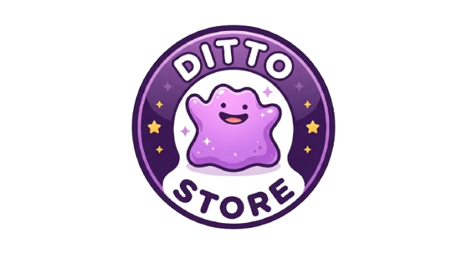
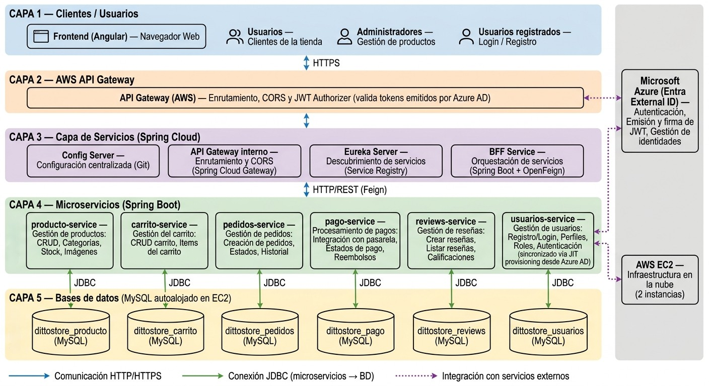

<p align="center">
  
</p>
<h1 align="center">Ditto Store</h1>
 
E-commerce de cartas Pokémon TCG construido con arquitectura de microservicios, autenticación real vía Microsoft Entra External ID, mensajería asíncrona con RabbitMQ y Apache Kafka, y despliegue en AWS.
 
---

## Descripción del proyecto

Ditto Store es una tienda en línea de cartas y cajas de Pokémon TCG. El sistema no cuenta con registro propio de usuarios: la autenticación se delega completamente a un tenant de **Microsoft Entra External ID**, y el rol de cada usuario (Cliente o Administrador) se gestiona en el backend propio.

La aplicación está compuesta por:

- Un **backend de microservicios** en Spring Boot, con descubrimiento de servicios, configuración centralizada y un Backend For Frontend (BFF) que valida los tokens JWT.
- Un **frontend en Angular** con dos experiencias diferenciadas por rol: la tienda para clientes y un panel de administración.
- Una capa de **API Manager en AWS** (HTTP API Gateway) que actúa como puerta de entrada pública al backend, con su propio Authorizer JWT.
- Un **clúster RabbitMQ de 2 nodos** para la comunicación asíncrona entre microservicios, con colas, exchanges, DLQ y un microservicio administrador (`rabbit-admin-service`).
- Un **clúster Apache Kafka de 3 brokers** (con 3 nodos ZooKeeper) para el flujo de eventos de pedidos y alertas de pago, con un microservicio administrador (`kafka-admin-service`) y Kafka UI.

---

## Arquitectura


La autenticación corre en paralelo: el frontend usa **MSAL** para autenticar contra Azure AD, obtiene un token JWT, y ese mismo token viaja en cada request hasta el BFF (o directo a `producto-service`/`reviews-service` en las rutas que van sin pasar por el BFF), que lo valida (firma, issuer, audience y vigencia) antes de dejar pasar la petición.

> Hay **dos capas de CORS** independientes en el camino: la del AWS API Gateway (a nivel de API, configurable en la consola) y la del API Gateway interno de Spring (`CorsConfig.java`). Si se agrega un nuevo dominio de frontend, hay que agregarlo **en ambas**, o el backend interno rechazará la petición con `403` aunque AWS ya la haya dejado pasar (ver [Problemas conocidos](#-problemas-conocidos-y-sus-soluciones)).

---

## Stack tecnológico

| Capa | Tecnología |
|---|---|
| Backend | Java 17, Spring Boot 4.0.8, Spring Cloud (Eureka, Config Server, Gateway, OpenFeign) |
| Base de datos | MySQL 8 |
| Mensajería (colas) | RabbitMQ 4.2 (clúster de 2 nodos con Docker Compose), Spring AMQP |
| Mensajería (streaming) | Apache Kafka (imágenes Confluent `cp-kafka` y `cp-zookeeper` 7.5.0, 3 brokers + 3 ZooKeeper con Docker Compose), Spring for Apache Kafka, Kafka UI |
| Frontend | Angular (standalone components), MSAL v4 |
| Autenticación | Microsoft Entra External ID (Azure AD, tipo CIAM) |
| Nube | AWS (EC2, API Gateway) — cuenta de laboratorio estudiantil |
| Hosting frontend | Netlify (build vía variable de entorno, ver más abajo) |
| Build | Maven (backend), Angular CLI (frontend) |

---

## Estructura del repositorio

```
DittoStore/
├── backend/
│   ├── pom.xml                      # POM padre (dependencias compartidas)
│   ├── infrastructure/
│   │   ├── pom.xml
│   │   ├── eureka-server/
│   │   ├── config-server/
│   │   ├── api-gateway/             # Gateway interno Spring Cloud (CORS + rutas)
│   │   ├── bff-service/
│   │   ├── rabbit-admin-service/    # Administrador REST de colas, exchanges y bindings
│   │   └── kafka-admin-service/     # Administrador REST de tópicos y consumer groups de Kafka
│   └── businessdomain/
│       ├── pom.xml
│       ├── producto-service/
│       ├── usuarios-service/
│       ├── carrito-service/
│       ├── pedidos-service/
│       ├── pago-service/
│       └── reviews-service/
├── config-repo/                     # Configuración centralizada (Config Server)
├── docker-compose.yml               # Clúster RabbitMQ de 2 nodos
├── docker-compose.kafka.yml         # Clúster Kafka (3 ZooKeeper + 3 brokers + Kafka UI)
├── rabbitmq/
│   └── cluster.conf                 # Formación automática del clúster
├── kafka/
│   ├── crear-topicos.sh             # Crea los tópicos de kafka/topics/ vía kafka-admin-service
│   ├── inspeccionar.sh              # Lista y describe tópicos y consumer groups
│   └── topics/
│       ├── pedidos.eventos.json
│       └── pagos.alertas.json
└── frontend/
    ├── set-env.js                   # Genera environment.prod.ts en cada build (ver más abajo)
    ├── src/app/
    │   ├── core/                    # Servicios, guards, modelos compartidos
    │   ├── features/
    │   │   └── admin/               # Panel de administración
    │   ├── shared/                  # Navbar, footer, componentes reutilizables
    │   ├── pages/                   # Páginas públicas de la tienda
    │   └── msal.config.ts           # protectedResourceMap: qué rutas llevan el Bearer token
    └── src/environments/
```

---

## Requisitos previos

- Java 17
- Maven (o usar el wrapper `./mvnw` incluido)
- Node.js 18+ y npm
- MySQL (local, ej. vía Laragon/XAMPP, o accesible remotamente)
- Docker y Docker Compose (para RabbitMQ y Kafka)
- Angular CLI (`npm install -g @angular/cli`)
- Una cuenta de Azure con un tenant de Microsoft Entra External ID configurado (ver sección de Autenticación)

---

## Levantar el backend en local

1. **Configura MySQL**: crea las 6 bases de datos vacías (se autogeneran las tablas vía JPA):
```sql
   CREATE DATABASE dittostore_producto;
   CREATE DATABASE dittostore_usuarios;
   CREATE DATABASE dittostore_carrito;
   CREATE DATABASE dittostore_pedidos;
   CREATE DATABASE dittostore_pago;
   CREATE DATABASE dittostore_reviews;
```
   Por defecto, cada microservicio se conecta con el usuario `root` sin contraseña (ajusta en cada `application.properties` si el entorno usa otras credenciales).

2. **Compila el backend completo**:
```bash
   cd backend
   ./mvnw clean package -DskipTests
```

3. **Levanta RabbitMQ** (desde la raíz del repositorio; sin archivo `.env` usa `guest/guest`):
```bash
   docker compose up -d
```
   Dashboard en `http://localhost:15672`.

4. **Levanta Kafka** (desde la raíz del repositorio; espera a que los 3 brokers queden `healthy`):
```bash
   docker compose -f docker-compose.kafka.yml up -d
   docker compose -f docker-compose.kafka.yml ps
```
   Kafka UI en `http://localhost:8090`. Los brokers quedan en `localhost:9092`, `localhost:9093` y `localhost:9094`.

5. **Levanta la infraestructura** (cada servicio en su propia terminal, o usando Spring Boot Dashboard):
```bash
   # 1. Eureka Server (registro de servicios)
   java -jar infrastructure/eureka-server/target/eureka-server-0.0.1-SNAPSHOT.jar

   # 2. Config Server (configuración centralizada, vía config-repo/ en este mismo repo)
   java -jar infrastructure/config-server/target/config-server-0.0.1-SNAPSHOT.jar

   # 3. API Gateway, BFF y administradores de RabbitMQ y Kafka
   java -jar infrastructure/api-gateway/target/api-gateway-0.0.1-SNAPSHOT.jar
   java -jar infrastructure/bff-service/target/bff-service-0.0.1-SNAPSHOT.jar
   java -jar infrastructure/rabbit-admin-service/target/rabbit-admin-service-0.0.1-SNAPSHOT.jar
   java -jar infrastructure/kafka-admin-service/target/kafka-admin-service-0.0.1-SNAPSHOT.jar
```

6. **Crea los tópicos de Kafka** (el clúster tiene la creación automática de tópicos desactivada, así que sin este paso los productores no pueden publicar). Desde la raíz del repositorio, con un JWT válido del tenant de Azure:
```bash
   BASE=http://localhost:8089 TOKEN=<JWT> ./kafka/crear-topicos.sh
```
   Detalle en [Streaming de eventos con Apache Kafka](#streaming-de-eventos-con-apache-kafka).

7. **Levanta los 6 microservicios de negocio** (orden indistinto entre ellos):
```bash
   java -jar businessdomain/producto-service/target/producto-service-0.0.1-SNAPSHOT.jar
   java -jar businessdomain/usuarios-service/target/usuarios-service-0.0.1-SNAPSHOT.jar
   java -jar businessdomain/carrito-service/target/carrito-service-0.0.1-SNAPSHOT.jar
   java -jar businessdomain/pedidos-service/target/pedidos-service-0.0.1-SNAPSHOT.jar
   java -jar businessdomain/pago-service/target/pago-service-0.0.1-SNAPSHOT.jar
   java -jar businessdomain/reviews-service/target/reviews-service-0.0.1-SNAPSHOT.jar
```

8. **Verifica**: entra a `http://localhost:8761` — deberías ver los 12 servicios registrados como `UP`.
---
### Puertos de referencia
---
| Servicio | Puerto |
|---|---|
| Eureka Server | 8761 |
| Config Server | 8888 |
| API Gateway (interno) | 8080 |
| BFF Service | 8081 |
| producto-service | 8082 |
| usuarios-service | 8083 |
| carrito-service | 8084 |
| pedidos-service | 8085 |
| pago-service | 8086 |
| reviews-service | 8087 |
| rabbit-admin-service | 8088 |
| kafka-admin-service | 8089 |
| RabbitMQ AMQP (nodo 1 / nodo 2) | 5672 / 5673 |
| RabbitMQ Dashboard (nodo 1 / nodo 2) | 15672 / 15673 |
| Kafka brokers (kafka-1 / kafka-2 / kafka-3) | 9092 / 9093 / 9094 |
| Kafka UI | 8090 |

---

## Levantar el frontend en local

```bash
cd frontend
npm install --legacy-peer-deps
ng serve
```

Abrir `http://localhost:4200`. Por defecto, el `environment.ts` (development) apunta al backend local (`http://localhost:8081` / `http://localhost:8080`) — este archivo no se toca nunca, a diferencia de `environment.prod.ts` (ver sección siguiente).

> **Nota**: el proyecto usa detección de cambios *zoneless*. Si se construye un componente nuevo que actualiza datos dentro de un `.subscribe()` (HTTP, MSAL, etc.), la vista no se refresca sola — inyecta `ChangeDetectorRef` y llama a `detectChanges()` manualmente, o usa Angular Signals.

---

## Despliegue en AWS

### Instancias EC2

El backend está desplegado en **4 instancias EC2** (se dividió por las limitaciones de memoria de una cuenta de AWS Academy — una sola instancia `t3.small` de 2 GB de RAM no soporta los 12 servicios de Java más RabbitMQ y Kafka simultáneamente):

| Instancia | Contenido | IP elástica |
|---|---|---|
| `DittoStore` | MySQL, Eureka, Config Server, API Gateway, BFF, usuarios-service | *(ver configuración privada del equipo)* |
| `DittoStore-Negocio` | producto, carrito, pedidos, pago, reviews-service | *(ver configuración privada del equipo)* |
| `DittoStore-Rabbit` | Clúster RabbitMQ (docker-compose) y rabbit-admin-service | *(ver configuración privada del equipo)* |
| Instancia de Kafka | Clúster Kafka (`docker-compose.kafka.yml`: 3 ZooKeeper, 3 brokers y Kafka UI) | *(ver configuración privada del equipo)* |

Los microservicios de la segunda instancia, el `rabbit-admin-service` y el `kafka-admin-service` usan un perfil de Spring separado (`application-prod.properties`) que apunta a la IP **privada** de la primera instancia — el `application.properties` base sigue intacto en `localhost` para que el desarrollo local no se vea afectado.

---
### Levantar las instancias (consola AWS)
---
1. Entrar a la consola de AWS (o al portal del lab estudiantil, ej. AWS Academy Learner Lab) y arranca la sesión/lab.
2. Ir a **EC2 → Instancias**, seleccionar las cuatro instancias (`DittoStore`, `DittoStore-Negocio`, `DittoStore-Rabbit` y la de Kafka) y presionar **Iniciar instancia** en todas (si el lab no las levantó solo).
3. Esperar a que el estado quede en `Running` y anotar las IPs (pública/privada) — en un lab que se destruye y recrea, estas pueden cambiar.
---
### Levantar los servicios (dentro de cada instancia, por SSH)
---
Conéctate por SSH (o usa el acceso que te dé el lab) y ejecuta, en orden, en `DittoStore (ssh -i db_dittostore.pem ubuntu@35.171.64.101)`:

```bash
# MySQL normalmente arranca solo como servicio; si no, en Ubuntu:
sudo systemctl start mysql

# Servicios de infraestructura, cada uno en su propia sesión 
nohup java -Xms64m -Xmx192m -jar infrastructure/eureka-server/target/eureka-server-0.0.1-SNAPSHOT.jar > eureka.log 2>&1 &

nohup java -Xms64m -Xmx192m -jar infrastructure/config-server/target/config-server-0.0.1-SNAPSHOT.jar > config-server.log 2>&1 &

nohup java -Xms64m -Xmx192m -jar infrastructure/api-gateway/target/api-gateway-0.0.1-SNAPSHOT.jar > api-gateway.log 2>&1 &

nohup java -Xms64m -Xmx192m -jar infrastructure/bff-service/target/bff-service-0.0.1-SNAPSHOT.jar > bff-service.log 2>&1 &

nohup java -Xms64m -Xmx192m -jar businessdomain/usuarios-service/target/usuarios-service-0.0.1-SNAPSHOT.jar > usuarios-service.log 2>&1 &
```

Antes de levantar los microservicios de la segunda instancia, el clúster RabbitMQ de la tercera y el clúster Kafka de la cuarta deben estar arriba, y los tópicos de Kafka ya creados (ver [Despliegue de RabbitMQ en AWS](#despliegue-de-rabbitmq-en-aws) y [Despliegue de Kafka en AWS](#despliegue-de-kafka-en-aws)). Luego, en `DittoStore-Negocio (ssh -i db_dittostore.pem ubuntu@54.166.52.100)`:

```bash
nohup java -Xms64m -Xmx192m -jar businessdomain/producto-service/target/producto-service-0.0.1-SNAPSHOT.jar --spring.profiles.active=prod > producto.log 2>&1 &

nohup java -Xms64m -Xmx192m -jar businessdomain/carrito-service/target/carrito-service-0.0.1-SNAPSHOT.jar --spring.profiles.active=prod > carrito.log 2>&1 &

nohup java -Xms64m -Xmx192m -jar businessdomain/pedidos-service/target/pedidos-service-0.0.1-SNAPSHOT.jar --spring.profiles.active=prod > pedidos.log 2>&1 &

nohup java -Xms64m -Xmx192m -jar businessdomain/pago-service/target/pago-service-0.0.1-SNAPSHOT.jar --spring.profiles.active=prod > pago.log 2>&1 &

nohup java -Xms64m -Xmx192m -jar businessdomain/reviews-service/target/reviews-service-0.0.1-SNAPSHOT.jar --spring.profiles.active=prod > reviews.log 2>&1 &
```

Conectárse a MySQL directamente en la instancia con:
```bash
mysql -u root
```
---
### API Manager de AWS (HTTP API Gateway)

Rutas configuradas en el API Gateway (visibles en **API Gateway → tu API → Routes**):

| Ruta | Métodos | Autorización |
|---|---|---|
| `/api/productos` | `GET`, `POST` | Sin autorizador (pública) |
| `/api/productos/{id}` | `GET`, `PUT`, `DELETE` | Sin autorizador (pública) |
| `/{proxy+}` | `ANY` | JWT Authorizer (tenant de Azure) |
| `/{proxy+}` | `OPTIONS` | **Sin autorizador** — necesaria para que el preflight de CORS no choque con el JWT Authorizer de la ruta `ANY` |

El endpoint `GET` de productos quedan públicos porque no debería requerirse login solo para navegar el catálogo; todo lo demás (`/bff/*`, `/api/carritos/*`, `/api/pedidos/*`, `/api/pagos/*`, `/api/reviews/*`, `/api/usuarios/*`) cae en el catch-all `ANY /{proxy+}` y exige un JWT válido.

**CORS a nivel de API** (API Gateway → tu API → CORS):

- **Access-Control-Allow-Origin**: `http://localhost:4200`, `https://dittostore.netlify.app`
- **Access-Control-Allow-Headers**: `content-type`, `authorization`
- **Access-Control-Allow-Methods**: `GET`, `POST`, `PATCH`, `PUT`, `DELETE`, `OPTIONS`
- **Access-Control-Allow-Credentials**: No

> Esta configuración de CORS y las rutas anteriores viven **únicamente en el recurso de AWS**, no en el código — si el API Gateway se recrea (ver más abajo), hay que rehacerlas a mano.

### Cuando el API Gateway cambia de ID

Si AWS genera el ID del API Gateway automáticamente y no se puede fijar, cada vez que el lab se recrea hay que hacer:

1. **Recrear las rutas y el CORS** de la tabla de arriba en el API Gateway nuevo (y volver a asociar el JWT Authorizer a `ANY /{proxy+}`).
2. **Copiar el nuevo Invoke URL** del API Gateway (algo como `https://<nuevo-id>.execute-api.us-east-1.amazonaws.com/dev`).
3. **Actualizar la variable de entorno `API_GATEWAY_URI` en Netlify** (Site configuration → Environment variables) con ese nuevo valor — **no** se edita `environment.prod.ts` a mano.
4. **Disparar un nuevo deploy en Netlify** (push, o *Trigger deploy* manual). El build corre `npm run build:prod`, que ejecuta `frontend/set-env.js` y regenera `environment.prod.ts` con la URL nueva
